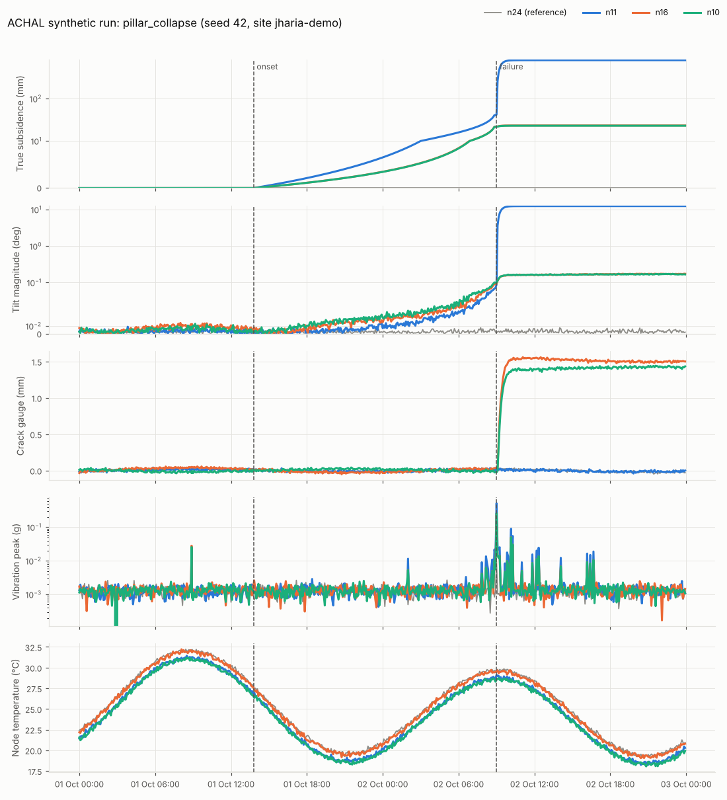

# Field simulator: ground, sensor and scenario model

`services/field-sim` stands in for the field this round. It generates what 25 low-cost surface
nodes over a Jharia-type bord-and-pillar panel would report, together with the ground truth the
risk engine is scored against. **Everything it produces is synthetic.** Every number below is a
simulation assumption chosen from the literature or from datasheets of the planned parts; each
one is a named constant in the code so it can be calibrated against CMPDI, BCCL or DGMS records.

Code: `services/field-sim/src/achal_sim/` (`geomech.py` ground physics, `sensors.py` node
hardware, `scenarios.py` the five scenarios, `simulator.py` the stepper, `export.py` files,
`plot.py` figures). Tests: `services/field-sim/tests/test_field_sim.py`.

## Study area

From `config/sites/jharia-demo.yaml`: a 100 m x 100 m panel at 60 m depth, 2.5 m seam
extraction, angle of draw 35 deg, with a 5 x 5 node grid at 22.5 m spacing. Positions are metres
from the panel's south-west corner, x east and y north.

## Ground movement

**Sign conventions.** Subsidence S is positive downwards (mm). Tilt is the slope of the upward
displacement, so `tilt_x_deg > 0` means the surface rises towards the east, and the western
flank of a trough has negative `tilt_x`. Horizontal displacement points towards the trough
centre. Strain is in mm/m and positive in tension.

**Knothe trough** (Knothe 1957). For a rectangular extraction between x1..x2 and y1..y2:

    S(x, y) = S_max * Fx(x) * Fy(y)
    Fx(x)   = 0.5 * [ erf( sqrt(pi) (x - x1) / r ) - erf( sqrt(pi) (x - x2) / r ) ]
    S_max   = a * m          (a = 0.6 subsidence factor, m = 2.5 m extraction  ->  1.5 m)
    r       = H * tan(angle of draw) = 60 * tan 35 deg = 42 m   (radius of major influence)

A panel narrower than about 2r is sub-critical and automatically subsides less than S_max at
its centre. The steepest slope of a full trough is S_max / r, at the panel edge (unit-tested).

**Horizontal movement and strain** follow the proportionality between horizontal displacement
and slope attributed to Aversin and Budryk (as presented in Kratzsch 1983 and Peng 1992):

    U = B * dS/dx,   B = r / sqrt(2 pi)      strain = dU/dx = B * d2S/dx2

so the ground is in tension beyond the panel edge (where cracks open) and in compression over
the goaf. Slopes and strains are taken by central differences with h = 5 cm on the analytic
surface.

**Development in time.** Knothe's first-order time function, dS/dt = c (S_final - S), gives
`S(t) = S_final (1 - exp(-c (t - t0)))`. The trough uses c = 0.15 per day (+/- 25% by seed).

**Pothole over a failing pillar.** Two Gaussian bowls `S = D exp(-rho^2 / R^2)` at the same
centre:

- *Precursor creep* over the pillar, D = 40-100 mm, R = r / sqrt(pi) (about 24 m: a pillar at
  60 m depth is felt at the surface through the Knothe kernel exp(-pi rho^2 / r^2), not just
  directly above it). It accelerates towards failure with a linear inverse velocity
  (Fukuzono 1985, alpha = 2): `v = 1 / (k (t_f - t))`, `u = (1/k) ln((t_f - t0) / (t_f - t))`,
  normalised to reach D ten minutes before failure. Unit tests check that 1/v is linear and
  extrapolates to t_f, which is exactly what the risk engine's time-to-failure estimate relies on.
- *Collapse* at t_f: D = 1.2-2.5 m, R = 5-8 m, with 1 - exp(-(t - t_f) / 15 min).

**Underground fire** (fire scenario). The surface over the fire warms by
`dT_max (1 - exp(-age / 30 h)) exp(-rho^2 / R(t)^2)`, with dT_max = 30-55 degC and a hot zone
that spreads from 10 m to 35 m at 0.4 m/h. Burning reduces support, so a broad sag of 80-160 mm
(R = 22 m) develops, and 12 h of accelerating creep end in a smaller pothole (0.6-1.0 m).
The fire timeline is compressed to four days so it can be demonstrated.

## Sensors and node hardware

| Channel | True signal | Error model |
| --- | --- | --- |
| `tilt_x_deg`, `tilt_y_deg` | atan(slope) | noise sd 0.002 deg, temperature coefficient sd 0.0006 deg/degC, random-walk wander 0.0002 deg/sqrt(h), range +/-15 deg |
| `crack_mm` | opening across a 1 m gauge once tensile strain passes 1 mm/m; ratchets (cracks do not close) | noise 0.01 mm, 0.002-0.006 mm/degC, range -5..50 mm |
| `ext_mm` | change in distance to the next node east (west for the last column) from U | noise 0.03 mm, 0.005-0.015 mm/degC (compensated wire), range +/-200 mm |
| `vib_rms_g`, `vib_peak_g` | sources below, attenuated exp(-d / L) | floor 0.0004 g RMS, peak 2.5-4x RMS |
| `temp_c` | Dhanbad late October: 25.5 +/- 5.5 degC, peak 14:30 IST, day-to-day offsets, fire heat | per-node offset sd 0.8 degC, noise 0.15 degC |
| `batt_v` | 18650 cell (3.4 Ah), 8 mA average load, 1 W solar panel (160 mA peak, 85% charge efficiency, daily cloud factor) | Li-ion OCV curve, noise 5 mV; the node stops sending below 2% charge |

Vibration sources: microseismic cracking near a failing pillar at a rate of
0.5/h x (t_f - t0) / (t_f - t), capped at 120/h, growing in size; the collapse itself (0.3 g,
30 s); aftershocks decaying as 1 / (1 + t / 0.5 h) (Omori-Utsu form) for 12 h; and
opencast blasting around midday IST on 70% of days, felt about equally by all nodes. Blasting
is a deliberate false-alarm trap present in every scenario.

## Scenarios

`SCENARIO` selects one; `SIM_SEED` makes it deterministic and also moves the event (location,
timing, size) inside the ranges above, so N seeds are N different events.

| Scenario | Default length | What happens | Hazard nodes |
| --- | --- | --- | --- |
| `normal` | 72 h | Stable ground: noise, diurnal temperature, battery cycles, blasts | none |
| `trough` | 21 days | Pillars crush under one half of the panel (east, west, north or south by seed); Knothe trough develops from ~24 h | final subsidence >= 10% of S_max or tensile strain >= 3 mm/m |
| `pillar_collapse` | 48 h | Onset 8-16 h, 18-30 h of accelerating creep, then a pothole | precursor creep or pothole >= 5 mm at the node |
| `faults` | 72 h | Stable ground; four nodes develop one fault each: `stuck`, `spike`, `drift`, `battery` | none |
| `fire` | 96 h | Fire below one corner; surface heats, sags, and a pothole opens 54-72 h after onset | heated >= 3 degC, or in the pothole zone |

Sensor faults: `stuck` repeats the last good tilt, crack and extensometer values; `spike` adds a
large random spike to one channel in 3% of samples; `drift` adds 0.01-0.03 deg/day of tilt and
0.1-0.3 mm/day of crack opening (a node settling on loose fill); `battery` is a failed charger
with a faded cell, so the voltage falls and the node eventually goes silent.

## Ground truth (`truth` field)

| Field | Meaning |
| --- | --- |
| `subsidence_mm` | true subsidence at the node |
| `event` | `collapse` > `precursor` > `trough` > `fire` > `blast` > `none` (first that applies) |
| `hazard` | true for `collapse`, `precursor`, `trough`, `fire`; false for `blast` and `none` |
| `fault` | set once an injected sensor fault is active on that node |
| `onset_ts` | (hazard rows) when the scenario's hazard process began |
| `failure_ts` | (hazard rows) pothole collapse time; for the trough, the first moment any node passes 10 mm/m tilt or 3 mm/m tensile strain |

Measure warning lead time against `failure_ts`. The risk engine must ignore `truth` when scoring.

**Trough damage thresholds.** 10 mm/m tilt and 3 mm/m tensile strain are used as "structural
damage begins" levels, in line with the damage classifications discussed in the NCB Subsidence
Engineers' Handbook (1975) and Peng (1992). They are assumptions to be replaced by DGMS guidance.

## Running

```bash
# live, into the gateway (Docker Compose sets these)
SCENARIO=pillar_collapse SIM_SEED=42 SIM_SPEED=600 python services/field-sim/src/field_sim.py
# SIM_PERIOD_S=600 SIM_SPEED=36000 plays the 21-day trough in about 50 minutes

# files: full-resolution runs -> data/runs/ (gitignored)
cd services/field-sim/src
python -m achal_sim.export --scenario all --seed 42 --gzip
# the small committed set in data/samples/ and the figures in docs/img/
python -m achal_sim.export --samples --plot ../../../docs/img      # plot needs matplotlib
```

From Python (what the KPI harness uses, no files needed):

```python
from achal_sim import simulate
for msg in simulate("pillar_collapse", seed=7):          # dicts in telemetry v1 form
    ...
simulate("trough", seed=3, period_s=600, every=1)        # coarser sampling for long runs
```

## Figures

`docs/img/scenario-<name>.png`, generated from the committed samples with seed 42. Each shows
the three most affected nodes in colour and the least affected node in grey.



## Limitations

- Ground parameters are generic, not fitted to a surveyed Jharia panel. The subsidence factor,
  time constant and pothole sizes are the first things to calibrate.
- Each node's extensometer measures only along one grid direction.
- Pillar failure is prescribed (time and place drawn from the seed), not computed from pillar
  strength. A pillar-strength model (for example the CMRI formula) is a natural next step.
- Fire heat transfer is a growing Gaussian hot zone, not a heat-flow model.
- Packet loss, duplicates and radio metrics come from the mesh model (W2), not from here.
